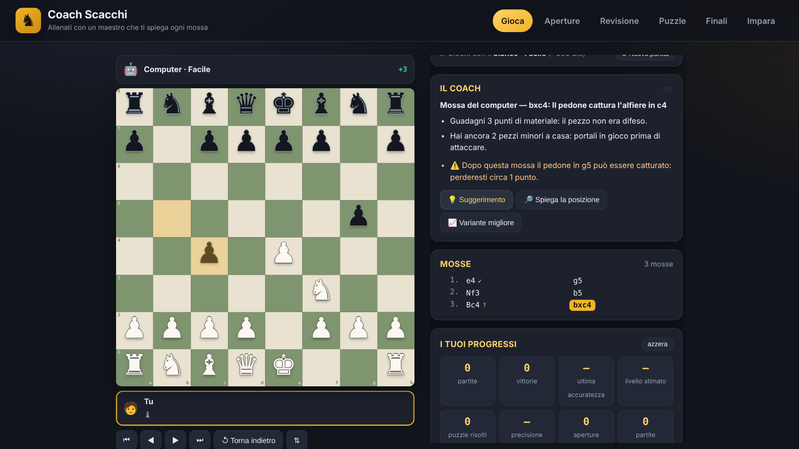
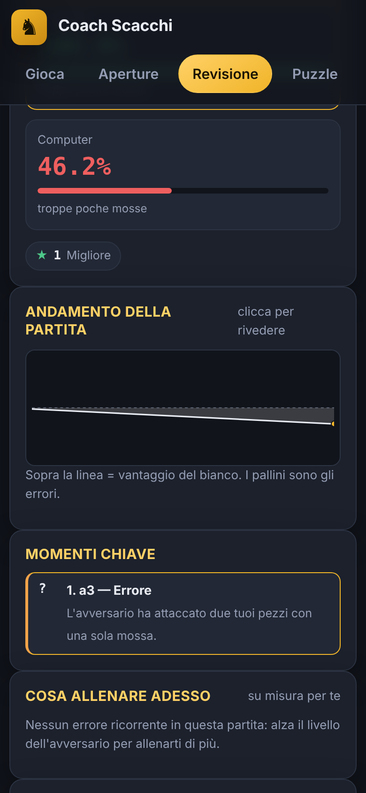

# ♞ Coach Scacchi

Allenatore di scacchi interattivo in italiano, pensato per chi sta fra i 500 e i 1000 Elo.
Non è solo un avversario: è un **coach che spiega ogni mossa passo per passo**, ti avvisa
*prima* che tu regali un pezzo e ti lascia tornare indietro per riprovare quante volte vuoi.

👉 **[Apri il sito](https://namsat.github.io/chess/)**



## Cosa puoi fare

**📊 Revisione completa della partita** (stile chess.com)
- **Accuratezza** in percentuale per entrambi i giocatori, calcolata sulla probabilità di vittoria
  mossa per mossa (stessa formula usata da chess.com e Lichess).
- **Livello espresso stimato** in Elo per quella partita.
- Ogni mossa classificata: Brillante `!!`, Mossa decisiva `!`, Migliore `★`, Teoria `📖`,
  Eccellente, Buona, Imprecisione `?!`, Occasione mancata `✗`, Errore `?`, Errore grave `??`.
- **Grafico dell'andamento** cliccabile: vedi dove la partita è girata.
- **Momenti chiave**: i tuoi errori più costosi, con la mossa giusta e le frecce sulla scacchiera
  (gialla = quello che hai giocato, verde = quello che andava giocato).
- **Diagnosi della causa**, non solo "hai sbagliato": pezzo lasciato indifeso, minaccia ignorata,
  difensore spostato, cattura che perde materiale, forchetta subita, re esposto, matto non visto,
  arrocco rimandato, donna fuori troppo presto, tempi persi.
- **Piano di allenamento personalizzato**: i tuoi 3 difetti ricorrenti con il pulsante che apre
  direttamente i puzzle di quel tema.
- **Profilo che cresce**: gli errori si accumulano partita dopo partita, così i consigli diventano
  sempre più mirati, con l'andamento della tua accuratezza nel tempo.



**🎮 Gioca con il coach**
- 5 livelli calibrati, da ~400 a ~1500 Elo (il livello 2 corrisponde a circa 600 Elo).
- Dopo ogni mossa il coach spiega in italiano cosa è successo: sviluppo, centro, minacce,
  forchette, inchiodature, pezzi lasciati in presa.
- Ogni tua mossa viene giudicata (★ migliore, ✓ buona, ?! imprecisione, ? errore, ?? errore grave).
- **Avviso anti-svista**: se stai per perdere materiale, un pop-up ti dice *cosa* perderesti
  e *come risponderebbe* l'avversario. Puoi ripensarci o giocare comunque.
- **💡 Suggerimento in 3 passi**: prima ti dice *dove guardare*, poi *quale pezzo muovere*,
  infine *la mossa* con la freccia sulla scacchiera. Impari a ragionare, non a copiare.
- **↺ Torna indietro** e frecce ◀ ▶ per rivedere la partita mossa per mossa e ripartire da qualsiasi punto.
- Segnalazione dei pezzi in presa, mosse legali evidenziate, barra di valutazione opzionale.

**📖 Aperture guidate** — 10 aperture + 4 trappole classiche, mossa per mossa, con il *perché*
di ogni mossa: Italiana, Spagnola, Scozzese, Londra, Gambetto di Donna, Siciliana, Caro-Kann,
Francese, Scandinava, Slava, matto del barbiere, Fegatello, trappola di Légal, matto del matto.
Provi a indovinare la mossa; se sbagli, il trainer ti spiega l'errore comune in quella posizione.

**🧩 20 puzzle tattici** verificati dal motore, divisi per tema (matto in 1 e in 2, forchetta,
infilata, inchiodatura, attacco di scoperta, vincere materiale, difendersi, trappole di apertura),
con 3 aiutini progressivi, soluzione animata passo per passo e la lezione da portare a casa.

**♔ Finali** — 5 esercizi di tecnica da giocare contro il computer (re+donna, re+torre, regola
del quadrato, matto della scala, pedoni passati) con la spiegazione del metodo.

**🎓 Impara** — la checklist delle "3 C", il valore dei pezzi, gli 8 principi dell'apertura,
i temi tattici e un programma di allenamento settimanale.

I progressi (partite, puzzle risolti, precisione, aperture studiate) restano nel tuo browser.

## Come funziona

Tutto scritto da zero in JavaScript, **zero dipendenze esterne**: nessuna libreria, nessuna
chiamata di rete, nessun dato che esce dal browser. Funziona anche offline.

| File | Cosa fa |
|---|---|
| `js/chess-core.js` | Motore di regole (rappresentazione 0x88): mosse legali, arrocco, en passant, promozione, SAN, FEN, matto/stallo/patta |
| `js/engine.js` | Valutazione + ricerca negamax con alpha-beta, quiescenza, estensione sugli scacchi, riduzioni, approfondimento iterativo con budget di tempo; livelli "umani" e rilevamento degli errori |
| `js/coach.js` | Traduce la posizione in italiano: perché una mossa è buona, cosa minaccia l'avversario, aiuti progressivi |
| `js/openings.js` | Repertorio di aperture, trappole, finali e principi |
| `js/puzzles.js` | Puzzle tattici con tema, aiuti e lezione |
| `js/review.js` | Revisione partita: win%, accuratezza, classificazione, rating stimato, diagnosi delle cause, piano di allenamento |
| `js/ui.js` | Scacchiera, pannelli, trainer, statistiche |

## Test

Il motore e i contenuti sono verificati automaticamente:

```bash
node tests/perft.js          # correttezza delle regole: perft su 6 posizioni standard
node tests/engine.test.js    # tattica, matti, valutazione, velocità dei livelli
node tests/content.test.js   # tutte le linee di apertura e i finali sono legali
node tests/puzzles.test.js   # ogni puzzle è risolvibile e la soluzione è la mossa migliore
node tests/coach.test.js     # le spiegazioni sono sensate e non vanno mai in errore
node tests/review.test.js    # accuratezza, classificazione, rating e diagnosi degli errori
node tests/browser.test.js   # test end-to-end in Chrome headless (richiede puppeteer)
```

`perft` è il test standard per i motori di scacchi: conta tutte le posizioni raggiungibili e
le confronta con i valori noti (197.281 posizioni a profondità 4 dalla posizione iniziale,
97.862 dalla "kiwipete", ecc.). Tutti i valori corrispondono.

## Note tecniche

- La scacchiera viene costruita una sola volta: ogni mossa aggiorna solo gli attributi che
  cambiano, con una breve animazione dello spostamento. Niente ricostruzione del DOM, quindi
  niente sfarfallio e niente salti della pagina (verificato dai test).
- Su PC la scacchiera si dimensiona sull'altezza della finestra e resta ferma mentre scorrono i
  pannelli; i pezzi sono proporzionali alla scacchiera (container query), non alla finestra.
- Su telefono le schede stanno su una riga scorrevole e i comandi sono grandi abbastanza da
  toccarli: nessuno scorrimento orizzontale a nessuna larghezza.
- L'analisi della partita gira a blocchi di ~70 ms con una barra di avanzamento, così
  l'interfaccia resta sempre reattiva.

## Uso locale

Basta aprire `index.html` nel browser: non serve nessun server né installazione.
